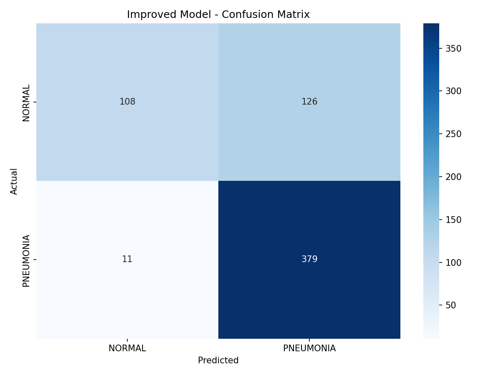
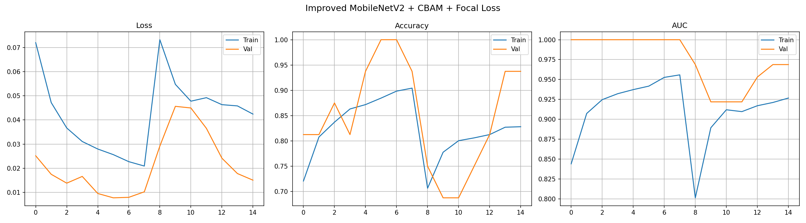
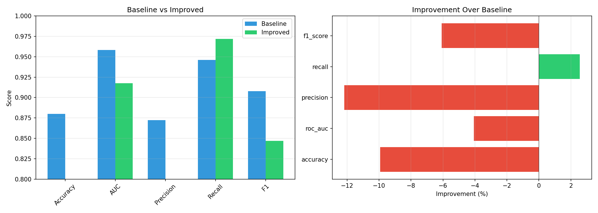

# Pediatric Pneumonia Detection from Chest X-Rays

Deep learning project that classifies pediatric chest X-rays as **NORMAL** or **PNEUMONIA**, built around a lightweight **MobileNetV2** backbone with **CBAM attention** and **Focal Loss**.

> **Author:** Mudassar Iqbal
> **Note:** This is a learning/research project, not a medical device. It must not be used for real diagnosis.

## Goal
Test whether adding attention (CBAM) and Focal Loss to a MobileNetV2 baseline improves pneumonia detection on a class-imbalanced chest X-ray dataset, while keeping the model small enough for resource-constrained use.

## Dataset
[Chest X-Ray Images (Pneumonia)](https://www.kaggle.com/datasets/paultimothymooney/chest-xray-pneumonia) (Kermany et al.), 5,856 pediatric chest X-ray images (ages 1-5) from Guangzhou Women and Children's Medical Center.

| Split | Normal | Pneumonia | Total |
|---|---|---|---|
| Train | 1,341 | 3,875 | 5,216 |
| Validation | 8 | 8 | 16 |
| Test | 234 | 390 | 624 |

About 73% of the images are pneumonia, so the data is imbalanced. The dataset is **not** included in this repo; the notebook downloads it with `kagglehub`.

## Approach
- **Backbone:** MobileNetV2, ImageNet pre-trained (about 3.4M parameters)
- **Attention:** CBAM (channel attention r=16, then spatial attention k=7) on the backbone's feature maps
- **Loss:** Focal Loss (gamma=2.0, alpha=0.25)
- **Augmentation:** rotation, shifts, zoom, shear, horizontal flip, brightness
- **Training:** two phases: (1) train the head with the base frozen, (2) fine-tune the top layers at a lower learning rate
- **Callbacks:** EarlyStopping (val AUC), ReduceLROnPlateau, ModelCheckpoint
- CLAHE contrast enhancement was tested and dropped because it did not help on this dataset.

## Results (test set, 624 images)

| Model | Accuracy | ROC-AUC | F1 |
|---|---|---|---|
| MobileNetV2 baseline | 87.98% | 95.82% | 90.77% |
| MobileNetV2 + CBAM + Focal Loss | 78.04% | 91.75% | 84.69% |





**The CBAM + Focal Loss model did not beat the baseline in this run.** Possible reasons, which I have not yet verified:
- The focal loss applies `alpha` equally to both classes, so it does not actually re-weight the minority class.
- The default 0.5 decision threshold may not suit an imbalanced test set (AUC is much higher than accuracy, which points to a threshold or calibration issue).
- The validation set has only 16 images, so early stopping and LR scheduling are noisy.

## Limitations
- Tiny validation set (16 images); results can vary a lot between runs.
- Single dataset from one hospital; no external validation.
- Single run, no cross-validation or confidence intervals.

## Possible next steps
- Use a class-balanced focal loss (`alpha_t`) and/or class weights.
- Tune the decision threshold on a validation split carved out of the training data.
- Create a larger validation set and repeat runs with different seeds.

## How to run
1. Open `pneumonia_improved.ipynb` in Google Colab and select **Runtime > Change runtime type > GPU**.
2. Run all cells. The dataset is downloaded automatically with `kagglehub`.
3. Figures are saved as PNG files in the working directory.

Requirements: TensorFlow 2.x, scikit-learn, seaborn, matplotlib, OpenCV, kagglehub.

## Repository contents
```
pneumonia_improved.ipynb                          main notebook
Automated_Pediatric_Pneumonia_Detection.pdf       project slides
improved_confusion_matrix.png                     result figure
improved_training_history.png                     result figure
model_comparison.png                              result figure
```

## Acknowledgements
Dataset by Kermany et al. (Guangzhou Women and Children's Medical Center), via Kaggle. Slides were prepared with Gemini Notebook.
